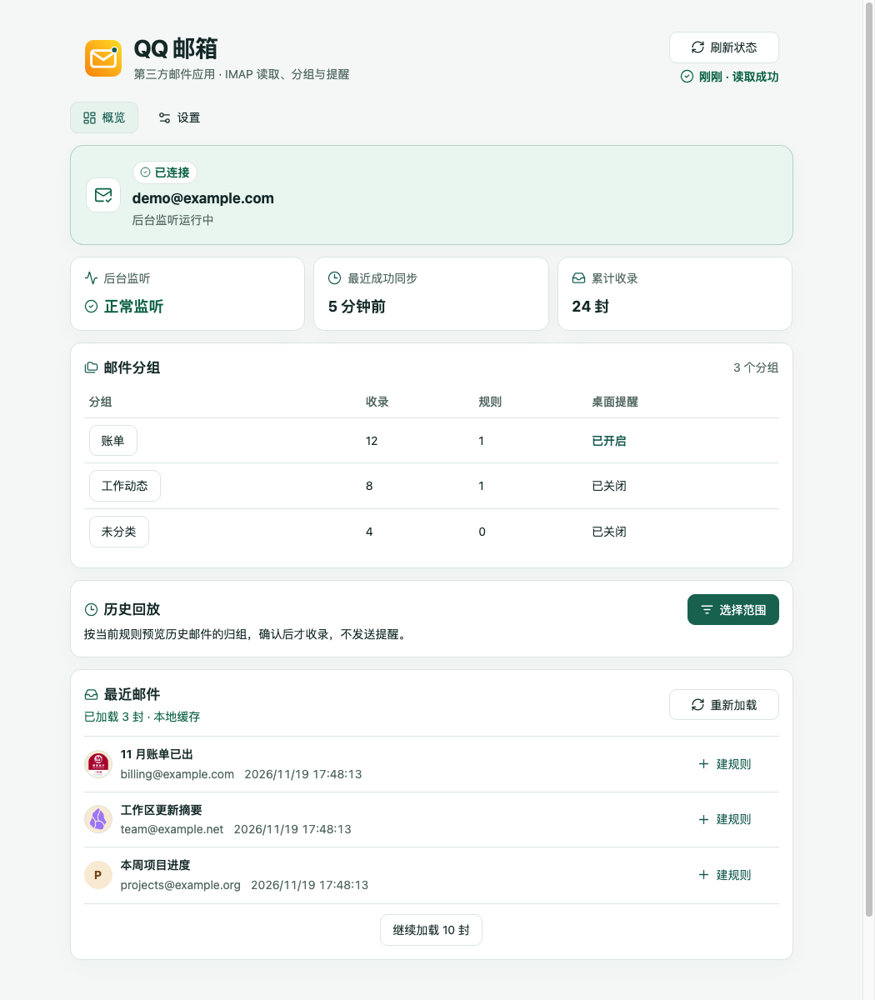
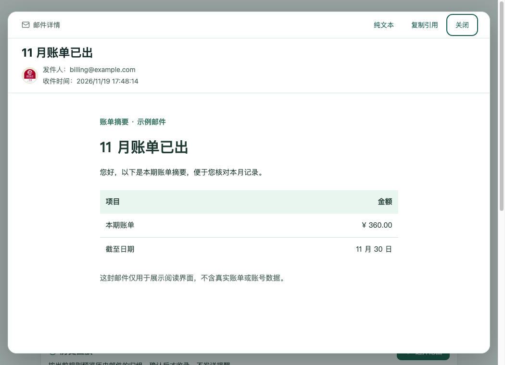
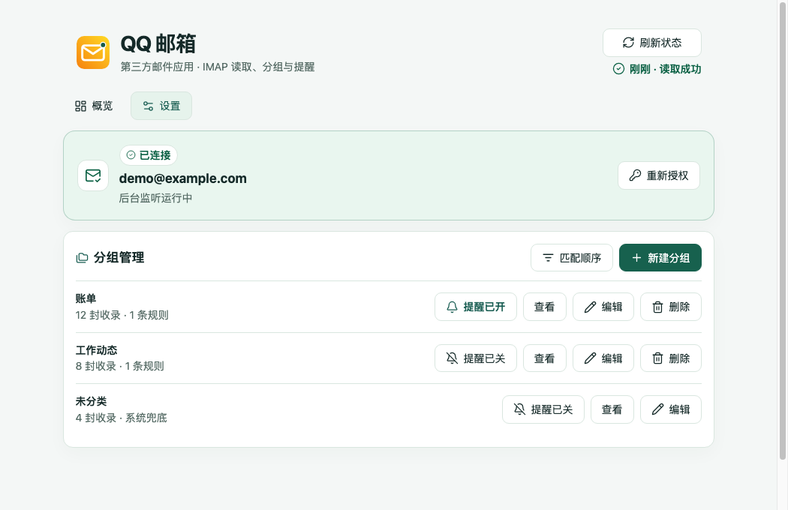

# QQ 邮箱 · Codex 本机插件

在 Codex 桌面端浏览 QQ 邮箱和 Foxmail，按规则归组、设置桌面提醒，并通过引用在对话中定位单封邮件或整个分组。这是第三方应用，不是腾讯官方客户端。当前通过 IMAP 只读连接，不会标记已读或修改邮箱原件。

## 安装

在 [Releases](../../releases/latest) 下载 macOS 安装包并解压。需要 Codex 或 ChatGPT Work 桌面版和 Python 3.9 或更新版本。

把解压后的目录拖进 Codex 对话，请它添加为本地插件市场并安装 `qq-mail-watch@qq-mail-local`。也可以在仓库根目录或解压后的目录运行：

```sh
codex plugin marketplace add "$PWD"
codex plugin add qq-mail-watch@qq-mail-local
```

打开侧边栏「QQ 邮箱 → 设置 → 打开本机授权」，在 Mac 弹窗输入邮箱地址和客户端授权码。安装包不含邮件数据或授权信息；每台 Mac 单独授权。

## 查看邮件

概览显示连接状态、最近同步、分组和最近邮件。收件箱按 10 封分页，重新打开页面会恢复已加载的列表。



点击邮件主题查看原文，也可切换纯文本或复制邮件引用。远程图片默认不加载。



在设置中按发件地址、主题或正文等条件归组，每组可单独开启提醒。截图均使用示例数据。


